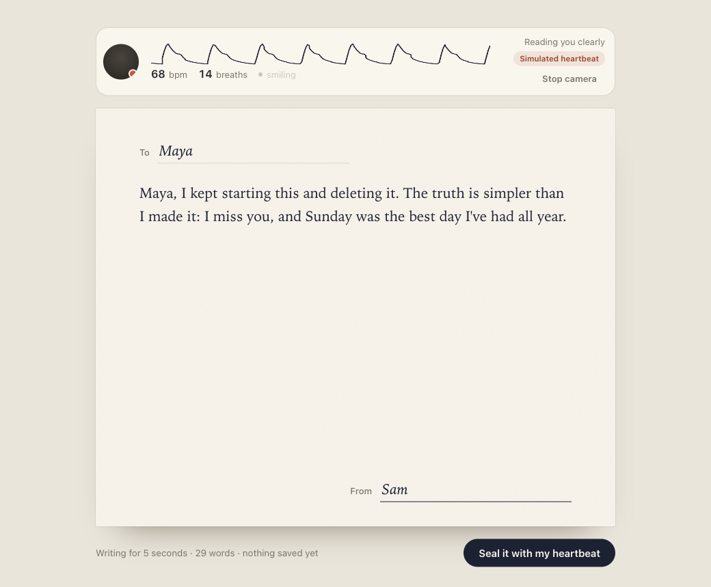
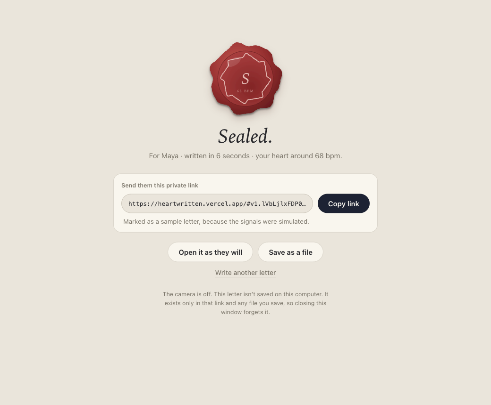
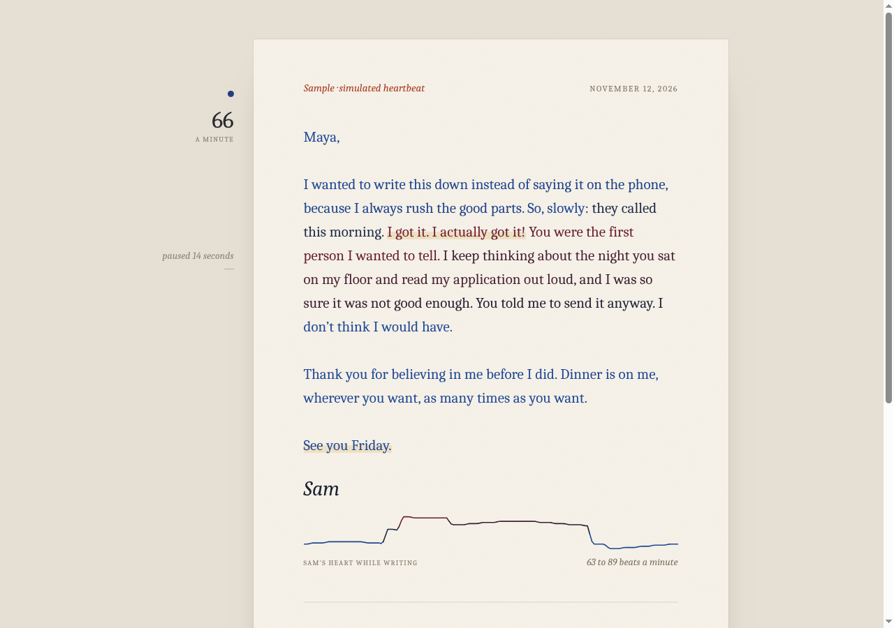

# Heartwritten

**Letters that carry the heartbeat you wrote them with.**

Heartwritten is a desktop app for writing a letter to someone you care about.
While you type, your laptop camera reads your heart rate, pulse wave, breathing
and smiles with the [Presage SmartSpectra SDK](https://physiology.presagetech.com),
and each word takes the ink of the heartbeat that wrote it. When you're done,
you seal it with a wax seal pressed from six seconds of your own pulse wave.

The person you send it to opens the envelope and watches the letter being
written again at your pace: the pauses where you thought, the sentence you
rushed, the ink warming where your heart sped up, the page rising and falling
with your breath, a soft glow where you smiled. At the end they see where your
heart was quickest and where it was steadiest.

The letter never goes to a server. A sealed letter lives inside its link (in
the part after `#`, which browsers never send) or inside a single HTML file.
There is no account and no database.

| Writing (camera on) | Sealed | Read by the person you sent it to |
| --- | --- | --- |
|  |  |  |

These screenshots were taken in simulated mode, which is why they say
"Simulated heartbeat". With a real key the same screens show your own signals.

## Try it in two minutes (no key, no camera)

You need Node 20 or newer.

```
npm install
npm run start:sim
```

`start:sim` runs the whole app with simulated signals, so you can try every
step (consent, writing, sealing, opening the letter) with no API key and no
camera. Letters written this way are marked as samples, everywhere. The first
start downloads the Electron runtime (about 100 MB), so give it a minute.

Or skip the install and open a finished letter in your browser:
[heartwritten.vercel.app/sample](https://heartwritten.vercel.app/sample). Its
heartbeat is simulated, and it says so. `npm run sample` builds the same letter
locally as `dist/sample-letter.html`.

`npm test` runs the 28 tests and needs no key either.

## Run it with your own heartbeat

You need a webcam and a SmartSpectra API key.

1. Get an API key from [physiology.presagetech.com](https://physiology.presagetech.com).
2. Put it in a file called `.smartspectra-key` in this folder (it's git-ignored),
   or set `SMARTSPECTRA_API_KEY` in your shell.
3. Check the SDK loads and the key is found: `npm run smoke`. It says where it
   found the key and never prints it. Presage checks the key itself when a
   measurement starts, so to test that too, pass a short video of a face:
   `npm run smoke -- path/to/face-clip.mp4`
4. Write a letter: `npm start`

The SDK ships native libraries for macOS on Apple silicon, Linux (x64 and arm64)
and Windows x64. Heartwritten has been run on macOS on Apple silicon only.
Measurement runs on your computer. Presage's documentation says the SDK needs a
network connection only so Presage can check the key.

## Sharing by link

The writer can save any letter as a file. To share by link instead, host the
reader page somewhere static and tell the writer its address:

```
npm run build          # makes dist/reader/index.html, one self-contained file
```

The hosted reader is at https://heartwritten.vercel.app, and the writer uses it
by default. To host your own, deploy `dist/reader` anywhere static (a
`vercel.json` is included), then put the address in `heartwritten.config.json`:

```json
{ "readerUrl": "https://your-reader.example" }
```

or set `HEARTWRITTEN_READER_URL`. The reader has a Content Security Policy of
`default-src 'none'; connect-src 'none'`, so once it has loaded it can't send
anything anywhere. Whoever hosts the page sees an ordinary page request (an IP
address and a browser), as any website does, but the letter in the `#` part of
the link never reaches the host or its logs.

## How it responds to human signals

| Signal (SmartSpectra) | While writing | In the letter |
| --- | --- | --- |
| Pulse rate (`cardio.pulseRate`, stable values only) | Live number, and each word takes its ink as you type it | Ink colour per character: iron-gall blue-black near the writer's own median, warming through claret to vermilion as the heart quickens, cooling to a clear blue-black as it settles. A pulse in the margin keeps time, and a heartline under the signature draws the whole letter's heart rate. The postscript finds the quickest and steadiest sentences. |
| Pulse wave (`cardio.arterialPressureTrace`) | Live trace | The wax seal: six seconds of the wave, wrapped into a ring and pressed into wax. Every seal is different. |
| Breathing (`breathing.upperTrace`, `breathing.rate`) | Breaths a minute | The paper rises and falls with the writer's breathing as it replays. |
| Smiles (`face.expression`, happy) | A small mark lights up | Words written while smiling glow softly. Optional. |
| Validation status | Plain-language hints: "move a little closer or further", "a little more light, please" | |

Typing is recorded as timed edits, so the replay keeps the real rhythm. Long
pauses (over eight seconds) are shortened in the replay but noted in the margin.
Words you delete are dropped from the letter unless you choose to share them.

## Privacy and consent

The consent screen comes before the camera turns on, and says plainly what is
read, what is kept and where it goes. See [PRIVACY.md](PRIVACY.md) for the full
data handling, including the SDK's telemetry, which is off unless you turn it on.

Heartwritten is for feeling, not medicine. Heart rate and breathing are camera
estimates. It makes no diagnosis, gives no health advice and isn't for
monitoring anyone.

## How it's built

```
app/main.cjs           Electron main: window, camera permission, SDK IPC, key lookup
scripts/               Build, the sample letter, and the SDK load check (`npm run smoke`)
src/writer/            The writing desk (consent → write → seal)
  sdk-source.js        SmartSpectra renderer SDK, events decoded into metrics
src/reader/            The reader, built into one self-contained HTML file
src/shared/
  vitals.js            Turns SDK metrics packets into steady pulse, breath and smile values
  recorder.js          Records timed edits and 4 Hz vitals while you write
  letter-format.js     Packs a letter into a compact, deflated, URL-safe token
  playback.js          Replays the edits and maps the heart to ink
  summary.js           Quickest and steadiest sentences, smiles, words taken back
  seal.js              Draws the wax seal from the pulse wave
  heartline.js         Draws the letter's heart rate as one line of ink
  sim-source.js        Simulated SDK output for development and tests
test/                  node --test: the core, plus the built pages in jsdom
```

`npm test` builds everything and runs 28 tests, including the reader replaying
a full letter and the writer going from consent to a sealed letter in
simulated mode.

The Electron wiring follows Presage's `electron-quickstart` sample: the main
process binds the SDK's IPC, the preload exposes it, and the renderer runs
`SmartSpectraSDK` with the camera.

## License

MIT for this code (see [LICENSE](LICENSE)). The SmartSpectra SDK has its own
license from Presage Technologies.
